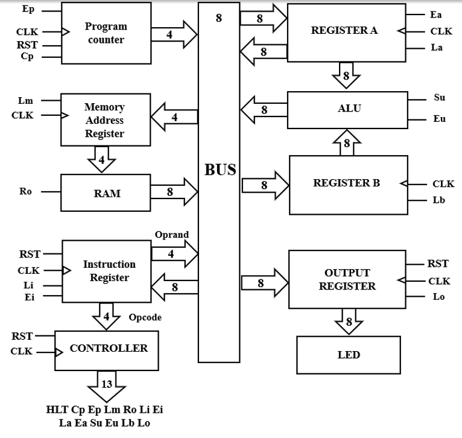

# SAP-1 (Simple-As-Possible 1) 8-Bit Microprocessor Architecture

## 1. Overview
This project presents a synthesizable **RTL implementation** and **functional verification** of an 8-bit SAP-1 (Simple-As-Possible 1) microprocessor based on the Von Neumann architecture, described in *Digital Computer Electronics* by Albert P. Malvino. 

The architecture features a single 8-bit common data bus utilizing **tri-state buffers** to eliminate data contention across shared registers and memory interfaces. A 6-stage finite state machine (FSM) sequence controls the instruction execution pipeline.

---
> 📄 **Full Technical Report:** [Read SAP-1 Microprocessor Design Report (PDF)](docs/SAP1_Report.pdf)
---

## 2. Hardware Architecture & Block Diagram



### Key Subsystem Components:
* **Clock Generator (`clock.v`):** Generates clock enable (`ce`) and internal timing ticks; halts execution upon receiving the `HLT` signal.
* **Program Counter (`pc.v`):** 4-bit counter storing the address of the next instruction.
* **Memory Address Register & RAM (`memory.v`):** 16x8-bit RAM preloaded with executable code (`program.bin`) via `$readmemh`.
* **Instruction Register (`ir.v`):** Decodes top 4 bits as opcode (`ir[7:4]`) and bottom 4 bits as address operand (`ir[3:0]`).
* **Accumulator & B-Register (`reg_a.v`, `reg_b.v`):** 8-bit general-purpose registers supplying operands to the arithmetic logic unit.
* **Adder/Subtractor (`adder.v`):** 8-bit arithmetic unit handling binary addition and two's complement subtraction.
* **Control Unit (`controller.v`):** Hardwired FSM controller generating a 13-bit microcode control word based on the current opcode and machine state (`T0`–`T5`).
* **Output Register (`out_reg.v`):** Laches execution results for external visualization.

---

## 3. Instruction Set Architecture (ISA) & FSM Cycle

The SAP-1 control unit operates on a 6-state ring sequence ($T_0$ to $T_5$):

| Opcode | Mnemonic | Machine Hex | Operation Description |
| :---: | :---: | :---: | :--- |
| `0000` | **LDA** | `0x0` | Load RAM content at address `M` into Accumulator A |
| `0001` | **ADD** | `0x1` | Add RAM content at address `M` to Accumulator A |
| `0010` | **SUB** | `0x2` | Subtract RAM content at address `M` from Accumulator A |
| `1110` | **OUT** | `0xE` | Load Accumulator A value into Output Register |
| `1111` | **HLT** | `0xF` | Stop machine clock generation |

### Micro-Operation Sequence ($T_0 - T_5$):
- **$T_0$ (Fetch 1):** $PC \rightarrow MAR$
- **$T_1$ (Fetch 2):** $PC \leftarrow PC + 1$
- **$T_2$ (Fetch 3):** $RAM \rightarrow IR$
- **$T_3$ (Execute 1):** Decode Opcode $\rightarrow$ Load Operand address to $MAR$ or trigger execution.
- **$T_4$ (Execute 2):** Read RAM data into Register A or Register B.
- **$T_5$ (Execute 3):** Perform Addition/Subtraction and store result back into Register A.

---

## 4. Directory Structure

```text
.
├── docs/                       # Architecture diagrams & design reports
│   ├── SAP1_Report.pdf         # Complete academic design report
│   └── sap1_architecture.png   # Block diagram image
├── rtl/                        # Synthesizable Verilog HDL Design Sources
│   ├── adder.v                 # 8-bit ALU (Add/Sub)
│   ├── clock.v                 # Clock divider and gating unit
│   ├── controller.v            # 6-state FSM controller (13 control lines)
│   ├── ir.v                    # Instruction register
│   ├── memory.v                # MAR and 16x8 RAM block
│   ├── out_reg.v               # Output display register
│   ├── pc.v                    # 4-bit Program counter
│   ├── reg_a.v                 # Accumulator Register A
│   ├── reg_b.v                 # Operand Register B
│   └── sap1_top.v              # Top-level integration module
├── sim/                        # Simulation & Verification Environment
│   ├── program.bin             # Binary machine code test file
│   ├── tb_sap1.v               # Full-system integration testbench
│   └── unit_tests/             # Unit-level & Subsystem testbenches
│       ├── tb_adder.v          # ALU unit test (Overflow/Underflow/Tri-state)
│       ├── tb_calc_group.v     # Datapath subsystem test (Reg A + Reg B + ALU)
│       ├── tb_clock.v          # Clock gating & halt unit test
│       ├── tb_control_group.v  # Control path subsystem test (PC + IR + Controller + RAM)
│       ├── tb_controller.v     # FSM control matrix unit test
│       ├── tb_ir.v             # IR decoding & High-Z unit test
│       ├── tb_memory.v         # RAM read/write addressing test
│       ├── tb_pc.v             # PC counter logic & rollover test
│       └── tb_reg_a.v          # Accumulator latch & bus driver test
└── README.md
```

---
## 5. Verification Strategy & Test Results

The verification approach follows industry-standard **bottom-up verification hierarchy**:

### Level 1: Unit-Level IP Verification (`sim/unit_tests/`)
Each individual module is verified with self-checking directed testbenches testing edge cases:
* **ALU (`tb_adder.v`):** Validates normal addition, 8-bit overflow ($250 + 10 = 4$), subtraction, two's complement underflow ($10 - 20 = 246$), and high-impedance (`8'bz`) outputs.
* **Controller (`tb_controller.v`):** Verifies all 13 control signal outputs across states $T_0$–$T_5$ against target control vectors with automatic `PASS/FAIL` checks.
* **Program Counter (`tb_pc.v`):** Tests asynchronous reset, count enable hold, linear counting sequence ($0 \rightarrow 15$), and rollover ($15 \rightarrow 0$).

### Level 2: Subsystem Integration Verification
* **Datapath Group (`tb_calc_group.v`):** Verifies bus arbitration and data transfer between Register A, Register B, and the ALU without bus contention.
* **Control Path Group (`tb_control_group.v`):** Verifies instruction fetch and state sequencing across PC, Memory, IR, and Controller.

### Level 3: Full-System Integration Test (`sim/tb_sap1.v`)
Executes the binary program loaded into `program.bin` ($3 + 4 - 2 = 5$):

```text
Addr  Hex Code  Mnemonic  Operation
0x0   0x0D      LDA 0xD   # Load A with RAM[0xD] (Value = 3)
0x1   0x1E      ADD 0xE   # Add RAM[0xE] (Value = 4) -> A = 7
0x2   0x2F      SUB 0xF   # Subtract RAM[0xF] (Value = 2) -> A = 5
0x3   0xE0      OUT       # Output A to display register (Result = 5)
0x4   0xF0      HLT       # Halt execution clock
```

---
## 6. How to Run Simulation

### Using Icarus Verilog & GTKWave (CLI):
To run any specific unit testbench (e.g., ALU testbench):
```bash
# Compile unit test
iverilog -o adder_sim rtl/adder.v sim/unit_tests/tb_adder.v
vvp adder_sim

# Compile full-system integration test
iverilog -o sap1_sim rtl/*.v sim/tb_sap1.v
vvp sap1_sim
gtkwave tb_sap1.vcd
```

### Using Xilinx Vivado (GUI):
1. Open Xilinx Vivado and create an RTL project.
2. Add all `.v` files from `rtl/` as **Design Sources**.
3. Add files from `sim/` and `sim/unit_tests/` as **Simulation Sources**.
4. Set the desired testbench (e.g., `tb_sap1` or `tb_controller`) as **Top Simulation Module** and click **Run Behavioral Simulation**.

The binary program (`program.bin`) loaded into memory tests the complete instruction chain:

```text
Address  Machine Code  Assembly Equivalent  Description
0x0      0x0D          LDA 0xD              # Load A with RAM[0xD] (Value: 0x03)
0x1      0x1E          ADD 0xE              # Add RAM[0xE] (Value: 0x04) -> A = 0x07
0x2      0x2F          SUB 0xF              # Sub RAM[0xF] (Value: 0x02) -> A = 0x05
0x3      0xE0          OUT                  # Display A (Output = 0x05)
0x4      0xF0          HLT                  # Halt execution
```

**Result:** The simulation waveform verifies that after $T_3$ of the `OUT` instruction, the output register captures `0x05` ($3 + 4 - 2 = 5$) and the system cleanly enters the halted state.